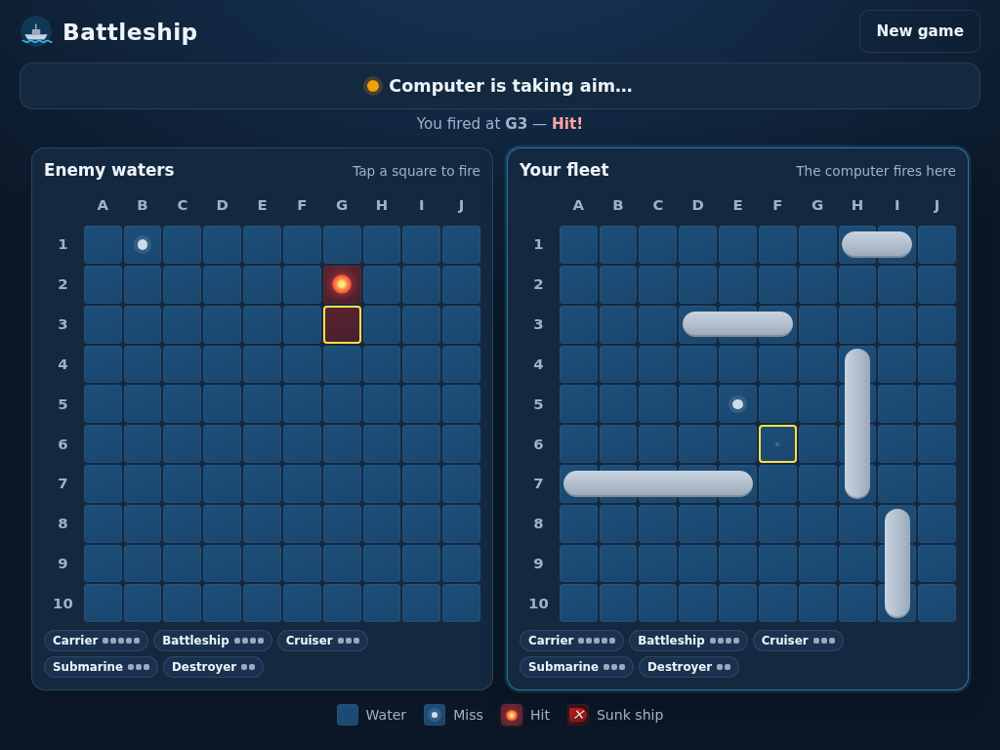

# Battleship

## ▶ [Play the live game](https://jonahthecodah.github.io/battleship-game/)

**No installation required.** The game runs in any modern browser (Chrome, Safari, Edge or Firefox) on a computer, tablet or phone.

Current release: **[v1.0.1](https://github.com/jonahthecodah/battleship-game/releases/tag/v1.0.1)**. The version is also shown under the game's title.



## Overview

A single-player Battleship game against a computer opponent on the classic 10×10 board. The whole game is one file, [`index.html`](index.html): plain HTML, CSS and JavaScript, with no frameworks, build step or server code. The animations are drawn on a canvas and the sound effects are generated in the browser.

- **Three difficulty levels:** Beginner fires mostly at random. Intermediate attacks the squares around each hit. Advanced works out where your ships are most likely to be. None of them can see your ships.
- **Effects:** missiles, explosions, splashes, sinking ships, sound and victory/defeat screens with battle stats. On devices set to reduce motion, results appear instantly.
- **Accessible controls:** mouse, touch or keyboard.

## How to play

1. **Place your fleet:** Carrier (5), Battleship (4), Cruiser (3), Submarine (3) and Destroyer (2). Choose **Horizontal** or **Vertical** (or press **R**), then tap a square on your board. Tap a placed ship to pick it up and move it, or use **Place randomly**.
2. **Choose a difficulty** and press **Start battle**.
3. **Fire:** tap a square in "Enemy waters". A splash means a miss, a scorch mark means a hit. When every square of a ship is hit, it sinks.
4. **The computer fires back** after each of your shots. The bar at the top shows whose turn it is.
5. **Win** by sinking all five enemy ships before the computer sinks yours. **New game** starts over at any time.

**Keyboard:** Tab to a board, move with the arrow keys, and press Enter or Space to place a ship or fire.

The **Animation demo** button opens a practice board for replaying the hit, miss and sink effects. It never affects the real game.

## Quality reports

| Report | What it covers |
| --- | --- |
| [Initial debugging report](DEBUGGING_REPORT.md) | The first QA pass (2026-11-13): code review and 154 automated browser checks. It found and fixed BUG-1 to BUG-5: effects from a finished game carrying into the next one, fireworks continuing after "Play again", missiles missing their square after a resize or rotation, the setup screen not fitting an upright tablet, and no keyboard play. |
| [Additional QA report](DEBUG_REPORT.md) | A second QA pass (2026-11-19 and 20): ship placement, turns, the computer opponent, hit/miss/sunk, win and loss, restarting, phones and console errors, plus a recorded manual play-through. It found and fixed BUG-6 to BUG-8 in the game (two animation-demo bugs and unusable boards on phones held sideways) and BUG-9 and BUG-10 in the test tooling. It also covers the review of the release process. |

All fixes from both reports are included in v1.0.1. [`CHANGELOG.md`](CHANGELOG.md) lists what changed in each version, and [`RELEASING.md`](RELEASING.md) describes how releases are tested, approved and deployed.

## Running it locally (optional)

Download this repository (green **Code** button, then **Download ZIP**), unzip it and double-click `index.html`. Any static web host can serve the same file.

## Automated tests (optional, for developers)

The tests play the game in a real browser using Python 3 and Playwright:

```bash
pip install playwright
playwright install chromium
scripts/run_tests.sh   # serves the game on port 8080 and runs every suite
```

You can also run the suites one at a time against `python3 -m http.server 8080`:

| Suite | Checks |
| --- | --- |
| `tests/test_game.py` | Placement, turns, hits, misses, sinking, winning and losing, the computer opponent (300 simulated games per level), layout on tablets and phones, animations, the demo, smoothness, reduced motion and keyboard play |
| `tests/test_qa_extra.py` | Edge and overlap placement, turn guards, the computer opponent (400 simulated games per level), resets, phone layouts, the version label and console errors |

GitHub Actions runs both suites on every pull request.
