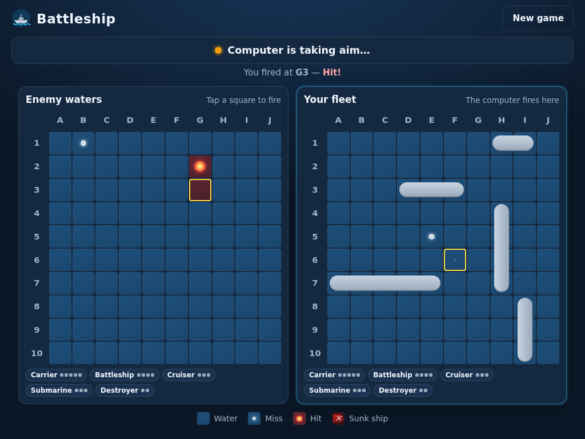

# Battleship

A fully playable Battleship game for the web browser: you against the computer on a classic 10x10 board. It works on computers, tablets and phones.



## What the game does

- **Place your fleet:** put your five ships (Carrier 5, Battleship 4, Cruiser 3, Submarine 3, Destroyer 2) on your board by tapping, turning them horizontally or vertically. You can also place them randomly. Tap a placed ship to move it.
- **The computer hides its fleet** at random positions you can't see.
- **Take turns firing:** tap a square in "Enemy waters" to fire. Then the computer fires back at your board.
- **Clear markers:** a white dot is a miss, a glowing red dot is a hit, and a sunk ship turns dark red with ✕ marks. Sunk ships are also crossed off the fleet list.
- **Turn display and winner:** the bar at the top always shows whose turn it is and what the last shot did. When one fleet is completely sunk, the winner is announced along with your stats.
- **Two difficulty levels:** *Easy* fires mostly at random. *Smart* works out where your ships are most likely to be, like a good human player would. It never peeks at your ships.

## How to run it

No installation is needed. The whole game is a single file, `index.html`.

1. Download this repository: click the green **Code** button, then **Download ZIP**, then unzip it.
2. Double-click `index.html`. The game opens in your web browser (Chrome, Safari, Edge or Firefox).

To have it at a web address on your tablet, the same file can be served by any static web host.

## Files

| File | What it is |
| --- | --- |
| `index.html` | The complete game: screen layout, styling and game rules in one file |
| `tests/test_game.py` | Automated tests that play the game in a browser and check it works correctly |
| `docs/screenshot.png` | The screenshot shown above |

## Running the automated tests (optional, for developers)

The tests need Python 3 and Playwright:

```bash
pip install playwright
playwright install chromium
python3 -m http.server 8080 &     # serve the game at http://localhost:8080
python3 tests/test_game.py
```

The tests check the placement rules, turn order, hits, misses, sunk ships, the winner announcement, the computer opponent (600 simulated games), and that the layout fits common tablet and phone screens.
